# HBNAP API

* [Introduction](#introduction)
* [Build HBNAP](#build-hbnap)
* [HBNAP Examples](#hbnap-api)
* [HBNAP Menu](#hbnap-menu)
* [UTF8 based](#utf8-based)
* [Runtime connection](#runtime-connection)
* [Data binding](#data-binding)
* [Table binding (TableView)](#table-binding-tableview)
* [Tree binding (TableView)](#tree-binding-tableview)
* [Multithreading](#multithreading)
* [HBNAP API Reference](#hbnap-api-reference)
    - [HBNAP_TIMER_START](#hbnap_timer_start)
    - [HBNAP_TIMER_STOP](#hbnap_timer_stop)
    - [HBNAP_FORMS_LOAD](#hbnap_forms_load)
    - [HBNAP_FORMS_DESTROY](#hbnap_forms_destroy)
    - [HBNAP_FORMS_TITLE](#hbnap_forms_title)
    - [HBNAP_FORMS_SET_TEXT](#hbnap_forms_set_text)
    - [HBNAP_FORMS_SET_INT](#hbnap_forms_set_int)
    - [HBNAP_FORMS_SET_REAL](#hbnap_forms_set_real)
    - [HBNAP_FORMS_INSERT_TEXT](#hbnap_forms_insert_text)
    - [HBNAP_FORMS_GET_INT](#hbnap_forms_get_int)
    - [HBNAP_FORMS_EMBED](#hbnap_forms_embed)
    - [HBNAP_FORMS_BIND](#hbnap_forms_bind)
    - [HBNAP_FORMS_BIND_STORE](#hbnap_forms_bind_store)
    - [HBNAP_FORMS_TABLE_BIND](#hbnap_forms_table_bind)
    - [HBNAP_FORMS_AREA_REFRESH](#hbnap_forms_area_refresh)
    - [HBNAP_FORMS_AREA_RECNO](#hbnap_forms_area_recno)
    - [HBNAP_FORMS_TREE_BIND](#hbnap_forms_tree_bind)
    - [HBNAP_FORMS_ITEM_LIST](#hbnap_forms_item_list)
    - [HBNAP_FORMS_ONCLICK](#hbnap_forms_onclick)
    - [HBNAP_HOTKEY](#hbnap_hotkey)
    - [HBNAP_FORMS_MAXIMIZE](#hbnap_forms_maximize)
    - [HBNAP_FORMS_SHOW](#hbnap_forms_show)
    - [HBNAP_FORMS_MODAL](#hbnap_forms_modal)
    - [HBNAP_FORMS_MODAL_GTNAP](#hbnap_forms_modal_gtnap)
    - [HBNAP_FORMS_STOP_MODAL](#hbnap_forms_stop_modal)
    - [HBNAP_FORMS_CONTROL_FRAME](#hbnap_forms_control_frame)
    - [HBNAP_FORMS_UPDATE](#hbnap_forms_update)
    - [HBNAP_FORMS_MAIN_COVER](#hbnap_forms_main_cover)
* [HBNAP Menu API Reference](#hbnap-menu-api-reference)
    - [HBNAP_MENU_CREATE](#hbnap_menu_create)
    - [HBNAP_MENU_DESTROY](#hbnap_menu_destroy)
    - [HBNAP_MENU_ADD_ITEM](#hbnap_menu_add_item)
    - [HBNAP_MENU_INS_ITEM](#hbnap_menu_ins_item)
    - [HBNAP_MENU_DEL_ITEM](#hbnap_menu_del_item)
    - [HBNAP_MENU_COUNT](#hbnap_menu_count)
    - [HBNAP_MENU_GET_ITEM](#hbnap_menu_get_item)
    - [HBNAP_MENU_BAR](#hbnap_menu_bar)
    - [HBNAP_MENU_IS_MENUBAR](#hbnap_menu_is_menubar)
    - [HBNAP_MENU_POPUP](#hbnap_menu_popup)
    - [HBNAP_MENUITEM_CREATE](#hbnap_menuitem_create)
    - [HBNAP_MENUITEM_SEPARATOR](#hbnap_menuitem_separator)
    - [HBNAP_MENUITEM_SUBMENU](#hbnap_menuitem_submenu)
    - [HBNAP_MENUITEM_GET_TEXT](#hbnap_menuitem_get_text)
    - [HBNAP_MENUITEM_GET_SUBMENU](#hbnap_menuitem_get_submenu)

## Introduction

HBNAP is an API that will allow us to create cross-platform desktop applications (Windows/macOS/Linux) using Harbour. Windows/forms are designed using the [NappGUI Designer](./Designer.md) utility. The HBNAP functions are integrated into the [GTNAP](../Readme.md#introduction) library.

## Build HBNAP

HBNAP is built into GTNAP, extending its API, so we don't have to do anything special to compile it. Just run the build script in `contrib\gtnap`. More information at [Build GTNAP](../Readme.md#build-gtnap).

```
cd contrib/gtnap

:: Windows MinGW
build.bat -b [Debug|Release] -comp mingw64

:: Linux/macOS
bash ./build.sh -b [Debug|Release]
```

## HBNAP Examples

Examples in Harbour on the use of the HBNAP API can be found in [exemplohbnap.prg](../tests/cuademo/gtnap_cualib/exemplohbnap.prg) and [exemplohbnap_company.prg](../tests/cuademo/gtnap_cualib/exemplohbnap_company.prg).

To see the running examples, launch the application [Example](../Readme.md#compile-and-run-cualib-example). Then press the `HBNAP support` option and in the interactive menu press `Orçamento`. This will launch the forms implemented in the files cited above.

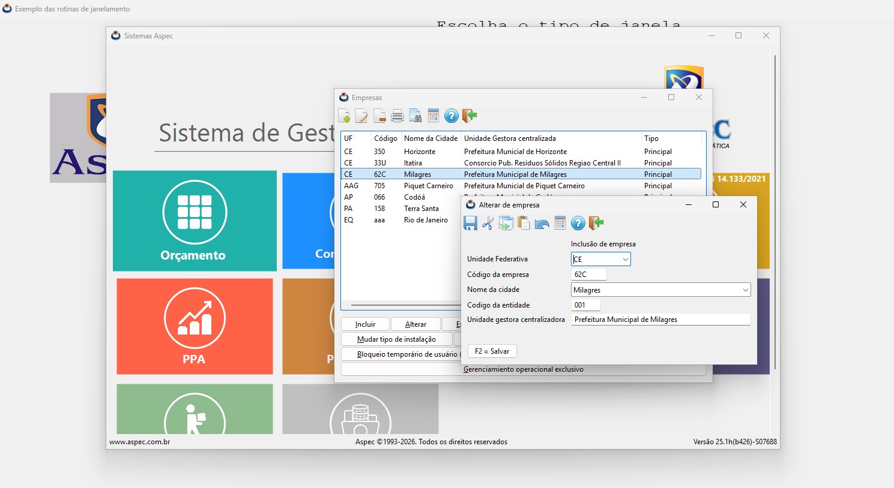

## HBNAP Menu

HBNAP provides an API to create dynamic menus and submenus at runtime. In the [Example](../Readme.md#compile-and-run-cualib-example) application, press the `HBNAP support` option and in the interactive menu press `Contábil SIAFIC (Check Menus)`. This will display an HBNAP form where you can interact with the HBNAP Menu API. You have the implementation of this example in [exemplohbnap_menu.prg](../tests/cuademo/gtnap_cualib/exemplohbnap_menu.prg).

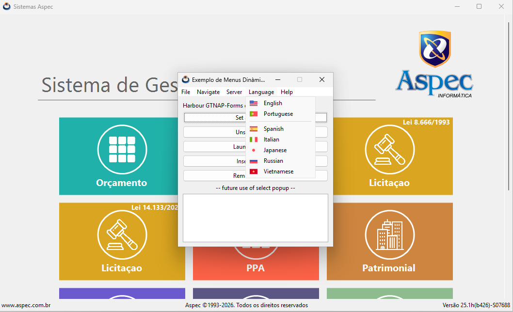

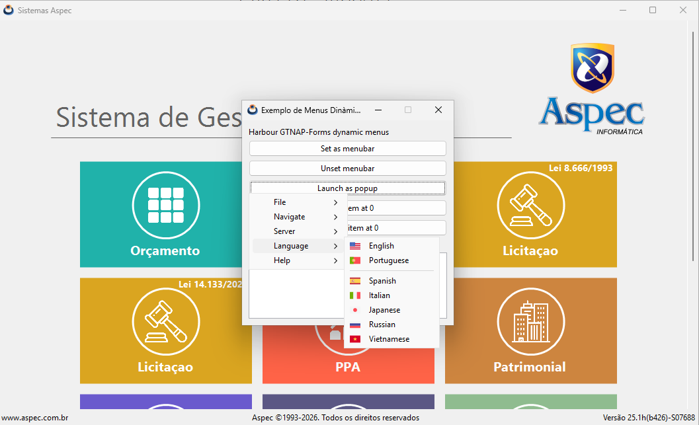

A menu can take the role of the HBNAP forms main menu (menubar) or be launched as a context menu (popup-menu). A menu is made up of several options (MenuItems). A MenuItem, in turn, can contain a submenu, forming a tree-like hierarchy. The API is quite intuitive and is based on four functions that allow you to create menu trees recursively.

```
// Create the menu containers
LOCAL O_MAINMENU := HBNAP_MENU_CREATE()
LOCAL O_FILEMENU := HBNAP_MENU_CREATE()

// Create the menu items
LOCAL O_MAINITEM1 := HBNAP_MENUITEM_CREATE("File", NIL, NIL)
LOCAL O_FILEITEM1 := HBNAP_MENUITEM_CREATE("Open", DIRET_FORMS() + "icons/open.png", {| O_ITEM | ITEM_CLICKED(O_FORM, O_ITEM)})
LOCAL O_FILEITEM2 := HBNAP_MENUITEM_CREATE("Save", DIRET_FORMS() + "icons/save.png", {| O_ITEM | ITEM_CLICKED(O_FORM, O_ITEM)})
LOCAL O_FILEITEM3 := HBNAP_MENUITEM_CREATE("Exit", DIRET_FORMS() + "icons/exit.png", {| O_ITEM | ITEM_CLICKED(O_FORM, O_ITEM)})

// Add items to menu
HBNAP_MENU_ADD_ITEM(O_FILEMENU, O_FILEITEM1)
HBNAP_MENU_ADD_ITEM(O_FILEMENU, O_FILEITEM2)
HBNAP_MENU_ADD_ITEM(O_FILEMENU, HBNAP_MENUITEM_SEPARATOR())
HBNAP_MENU_ADD_ITEM(O_FILEMENU, O_FILEITEM3)

// Recursion: Add a submenu to an item
HBNAP_MENUITEM_SUBMENU(O_MAINITEM1, O_FILEMENU)

// Add a item with submenu to a main menu
HBNAP_MENU_ADD_ITEM(O_MAINMENU, O_MAINITEM1)
```

## UTF8 based

HBNAP uses the **UTF8 format** throughout its API. We must be careful to save all source code files that contain texts in this format. NAppGUI Designer also uses UTF8 internally.

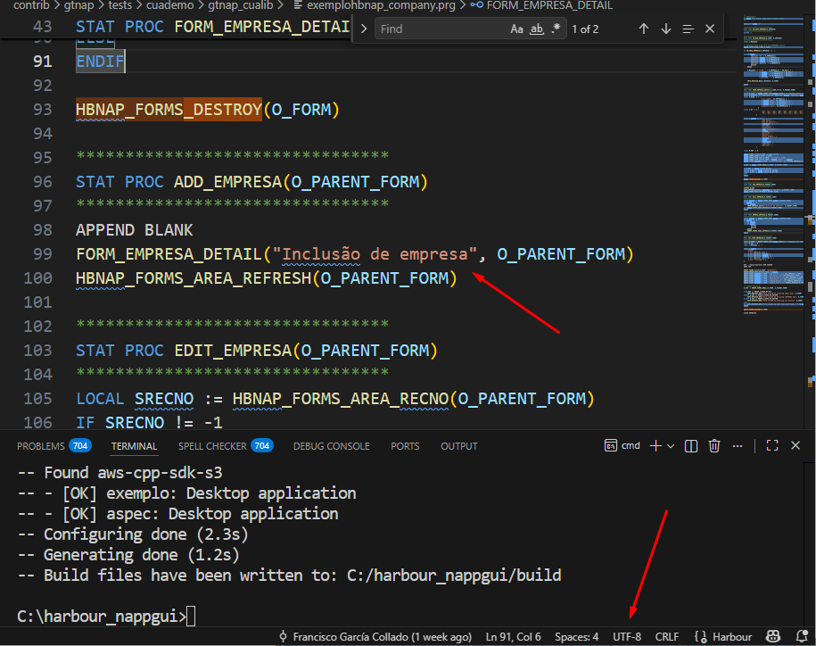

## Runtime connection

The runtime interaction between the form, loaded via a `*.nfm` file, and the Harbour code will be done through the widget cell name. For example, to change the text of a `Label` widget:

```
HBNAP_FORMS_SET_TEXT(O_MAINWINDOW, "version", "New Versão 28.1h(b765)-S09999")
```

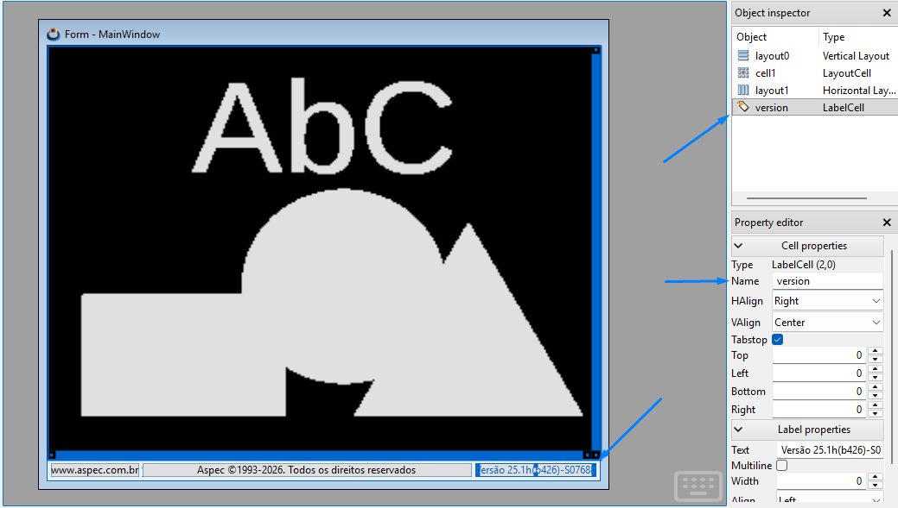

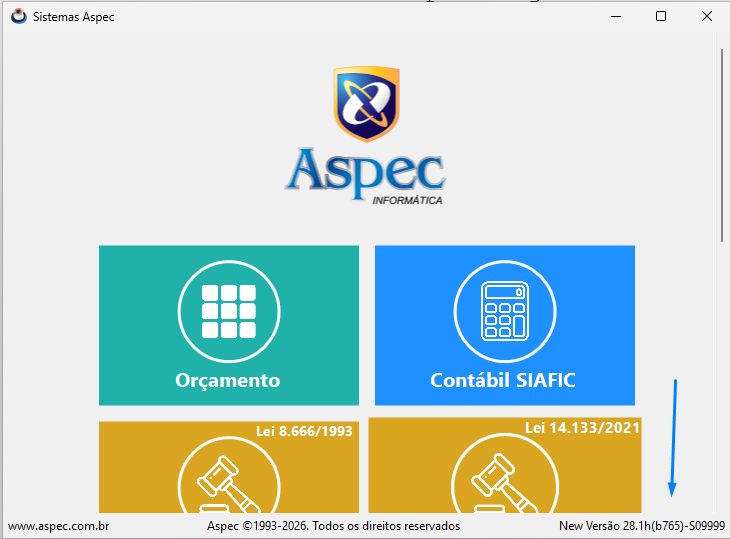

## Data binding

For the form to be truly practical, we must be able to "map" variables in Harbour with widgets within the form (for example EditBox). As we have already indicated, this binding will be done through the cell identifiers (Cell Name) and the `HBNAP_FORMS_BIND()` function

```
LOCAL O_EMPRESA := { empresas->uf, empresas->codcid, empresas->cidade, empresas->codent, empresas->gestora }
LOCAL V_BIND := { ;
                    {"uf_combo", @O_EMPRESA[1] }, ;
                    {"codcid_edit", @O_EMPRESA[2] }, ;
                    {"cidade_combo", @O_EMPRESA[3] }, ;
                    {"codent_edit", @O_EMPRESA[4] }, ;
                    {"gestora_edit", @O_EMPRESA[5] } ;

// Maps O_EMPRESA vector to form widgets
HBNAP_FORMS_BIND(O_FORM, V_BIND)
...
// Recovery data from form to O_EMPRESA vector
HBNAP_FORMS_BIND_STORE(O_FORM)
```

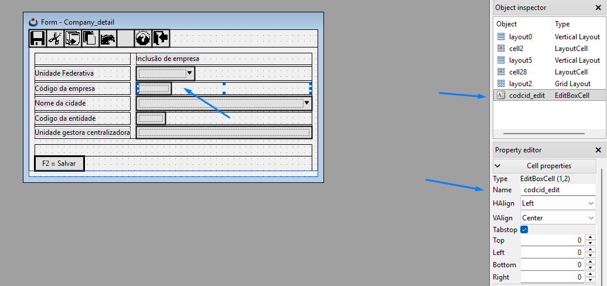

## Table binding (TableView)

In addition to binding widgets with variables, we can bind a database with a data view (TableView). To do this we will use the `HBNAP_FORMS_TABLE_BIND()` function.

```
LOCAL V_COLS := { ; // table columns
    { HBNAP_LEFT, {|| empresas->uf} }, ;
    { HBNAP_LEFT, {|| empresas->codcid} }, ;
    { HBNAP_LEFT, {|| empresas->cidade} }, ;
    { HBNAP_LEFT, {|| empresas->gestora} }, ;
    { HBNAP_LEFT, {|| "Principal"} } ;
}

USE ../dados/empresas NEW SHARED
GOTO TOP

HBNAP_FORMS_TABLE_BIND(O_FORM, "table", "EMPRESAS", V_COLS)
```

`"table"` is the `cellName` of the `TableView` control. `"EMPRESAS"` is the alias of the database opened with `USE...SHARED`. `V_COLS` is an array of column descriptors `{ alignment, {|| value_block} }`, one per table column — alignment constants (`hbnap.ch`): `HBNAP_LEFT`, `HBNAP_CENTER`, `HBNAP_RIGHT`.

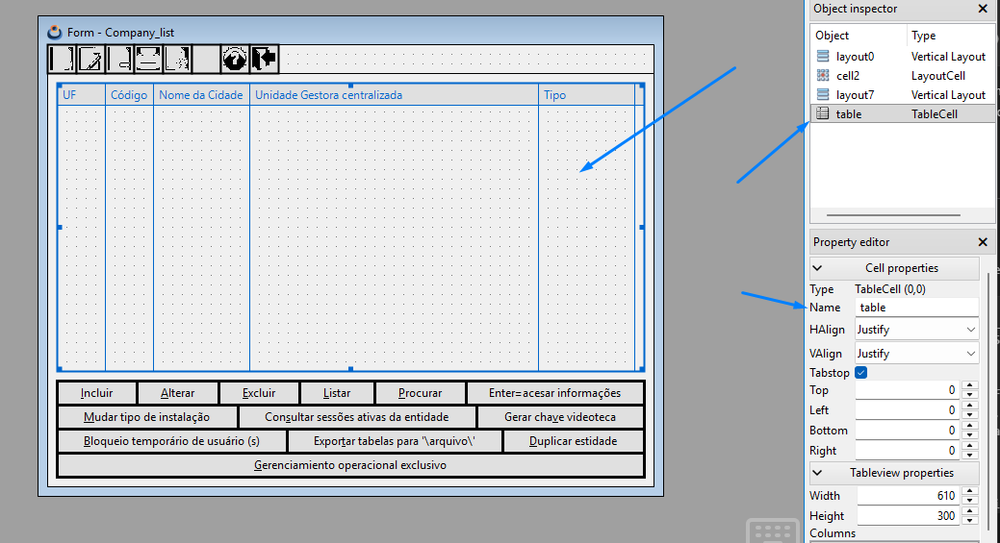

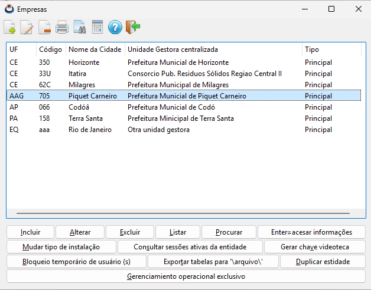

## Tree binding (TableView)

`HBNAP_FORMS_TREE_BIND()` links a `TableView` control to a hierarchy of N related Harbour databases (DBF/CDX), displaying them as an expandable tree. Each level of the tree corresponds to one database area.

The function requires at least two open areas. The root area must already have an active index order (via `SET ORDER TO TAG`). For child areas, the index is opened and activated by HBNAP itself. No `SET INDEX TO` or `SET ORDER TO` is needed in Harbour.

```harbour
LOCAL V_AREAS := { "CUSTOMER", "INVOICES", "DETAILS" }

LOCAL V_RELS := { ;
    { {|| CUSTOMER->CODIGO}, "../dados/invoices.cdx", "CODCLI"  }, ;
    { {|| INVOICES->NUMERO}, "../dados/details.cdx",  "CODINV"  } ;
}

LOCAL V_COLS := { ;
    { ; // Customer columns
        { HBNAP_LEFT,  {|| TRIM(CUSTOMER->NOME) + " (" + TRIM(CUSTOMER->NIF) + ")"} }, ;
        { HBNAP_RIGHT, {|| "--"} } ;
    }, ;
    { ; // Invoice columns
        { HBNAP_LEFT,  {|| "Invoice: " + hb_ntos(INVOICES->NUMERO) + " (" + DTOC(INVOICES->DATE) + ")"} }, ;
        { HBNAP_RIGHT, {|| hb_ntos(INVOICES->TOTAL)} } ;
    }, ;
    { ; // Detail columns
        { HBNAP_LEFT,  {|| PADL(hb_ntos(DETAILS->NUMLINHA), 3, "0") + "-" + TRIM(DETAILS->CONCEITO)} }, ;
        { HBNAP_RIGHT, {|| hb_ntos(DETAILS->TOTAL)} } ;
    } ;
}

USE ../dados/customer NEW SHARED
SET ORDER TO TAG CODIGO
GOTO TOP

USE ../dados/invoices NEW SHARED
USE ../dados/details  NEW SHARED

HBNAP_FORMS_TREE_BIND(O_FORM, "table", V_AREAS, V_RELS, V_COLS)
```

**`V_AREAS`** is an array of N area alias strings in parent->child order. Each alias must correspond to a database opened with `USE...SHARED`.

**`V_RELS`** is an array of N-1 relation descriptors, each connecting level[i] to level[i+1]. Every element has exactly three values:

```
{ {|| parent_key_block}, "path/to/child_index.cdx", "TAG_NAME" }

- Element 1: Code block evaluated in the parent area context. Returns the join key value.
- Element 2: Path to the CDX compound index file of the child area. Extension .cdx is optional.
- Element 3: Tag name within the CDX to activate on the child area.
```

HBNAP opens the CDX and sets the active order on the child area automatically. The key expression in the CDX tag must reference fields of the child area.

**`V_COLS`** is an array M sets (one per area) of N column descriptor arrays, one table column. Each entry is `{ alignment, {|| value_block} }`:

```
- Element 1: Column alignment constant HBNAP_LEFT, HBNAP_CENTER or HBNAP_RIGHT (hbnap.ch).
- Element 2: Code block evaluated to produce the cell text for a record.
             All ancestor cursors are pre-positioned, so the block may freely
             reference fields from any parent area in the hierarchy.
```

All column arrays must have the same number of columns, which determines the total columns in the `TableView`.

### Persist expanded/collapsed state

If any area contains a logical field named `EXPANDED`, HBNAP reads and writes it automatically to persist the expand/collapse state of each node across sessions. The field name is case-insensitive.

```
// Field definition in the DBF structure
{ "EXPANDED", "L", 1, 0 }
```

When the field is present, nodes initialize their expanded state from the database. Collapsing or expanding a node updates the record immediately (with automatic record locking).

### Performance lazy expansion

HBNAP uses lazy expansion: nodes with `expanded = .F.` do not have their subtree built at startup. This speeds up initial rendering on very large datasets. Instead, only the child count is computed via an indexed SEEK, so the expand arrow is shown without loading all descendant records into memory. The subtree is built on demand when the user expands the node.

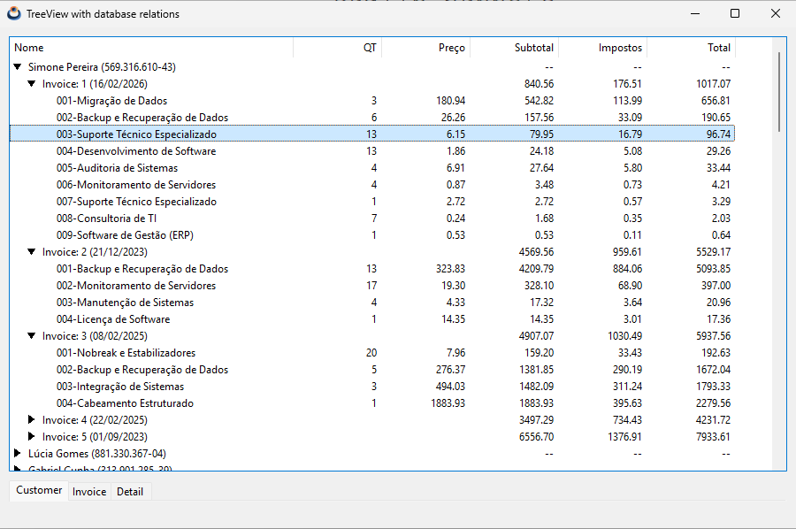

## Multithreading

NAppGUI runs on a single thread, which updates the GUI at regular time intervals (the application tick). Whenever there is a "hard" computational task - a database update, a large file copy, etc. - it must run on a separate, parallel thread (asynchronously), so the GUI thread is freed and never gets frozen by it. While that task runs, it can keep informing the GUI of its status through progress bars, labels, counters, and so on.

Since the GUI is only ever touched by that single thread, a worker thread must never call `HBNAP_FORMS_*` / `HBNAP_TIMER_*` directly - it only writes to state it shares with the main thread, which is read and reflected on the form widgets by the regular GUI tick.

> **A secondary thread must perform computation tasks only, and must NEVER update the GUI nor call any `HBNAP_*` function.**

The recommended pattern is:

1. Launch the task on a secondary thread with Harbour's own MT API (`hb_threadStart()`), guarding any state shared with the main thread behind a `hb_mutexCreate()`/`hb_mutexLock()`/`hb_mutexUnLock()`.
2. Poll that shared state from the main thread with `HBNAP_TIMER_START()`, at a short interval (e.g. every 50ms), and push the result into the form widgets (`HBNAP_FORMS_SET_TEXT()`, `HBNAP_FORMS_SET_REAL()`, ...). The worker thread never touches the form - only the main thread does, driven by the timer.
3. When the task finishes, return `.F.` from the timer callback to stop it, and close the dialog (typically with `HBNAP_FORMS_STOP_MODAL()`).
4. If the user can cancel early (e.g. pressing `[X]`), use the optional close-callback parameter of `HBNAP_FORMS_MODAL()` / `HBNAP_FORMS_MODAL_GTNAP()` / `HBNAP_FORMS_SHOW()` to signal the worker thread to stop cooperatively (never force-kill a thread), then `hb_threadJoin()` it once the dialog has actually closed.

> **Note:** using `hb_thread*`/`hb_mutex*` functions requires the `-mt` Harbour compiler flag in the project's `.hbp` file (multi-threaded RTL).

```harbour
STATIC H_MUTEX
STATIC N_PROGRESS
STATIC L_FINISHED
STATIC L_CANCELLED

STAT PROC WORKER()
    LOCAL N_STEP
    FOR N_STEP := 1 TO 100
        hb_idleSleep(0.050) // Simulates heavy work
        hb_mutexLock(H_MUTEX)
        IF L_CANCELLED == .F.
            N_PROGRESS := N_STEP / 100
        ENDIF
        hb_mutexUnLock(H_MUTEX)
        IF L_CANCELLED == .T.
            EXIT
        ENDIF
    NEXT
    hb_mutexLock(H_MUTEX)
    L_FINISHED := .T.
    hb_mutexUnLock(H_MUTEX)
    RETURN

STAT FUNC UPDATE_PROGRESS(O_FORM)
    LOCAL N_VALUE, L_DONE
    hb_mutexLock(H_MUTEX)
    N_VALUE := N_PROGRESS
    L_DONE := L_FINISHED
    hb_mutexUnLock(H_MUTEX)
    HBNAP_FORMS_SET_REAL(O_FORM, "progress", N_VALUE)
    IF L_DONE == .T.
        HBNAP_FORMS_STOP_MODAL(O_FORM, 0)
        RETURN .F. // Stop ticking
    ENDIF
    RETURN .T. // Keep ticking

STAT FUNC ON_CANCEL(N_TIMER_ID)
    hb_mutexLock(H_MUTEX)
    L_CANCELLED := .T.
    hb_mutexUnLock(H_MUTEX)
    HBNAP_TIMER_STOP(N_TIMER_ID)
    RETURN .T. // Allow the dialog to close

STAT PROC RUN_TASK(O_PARENT)
    LOCAL O_FORM := HBNAP_FORMS_LOAD(...)
    LOCAL H_THREAD, N_TIMER_ID, N_RES

    H_MUTEX := hb_mutexCreate()
    N_PROGRESS := 0
    L_FINISHED := .F.
    L_CANCELLED := .F.

    H_THREAD := hb_threadStart(@WORKER())
    N_TIMER_ID := HBNAP_TIMER_START(0.050, {|| UPDATE_PROGRESS(O_FORM) })
    N_RES := HBNAP_FORMS_MODAL(O_FORM, O_PARENT, {|| ON_CANCEL(N_TIMER_ID) })

    hb_threadJoin(H_THREAD)
    HBNAP_FORMS_DESTROY(O_FORM)
    RETURN
```

A complete, real-world example - a simulated 15-subtask database-loading progress dialog, with early-cancel support - can be found in [exemplohbnap_company.prg](../tests/cuademo/gtnap_cualib/exemplohbnap_company.prg) (`SIMULAR_ATUALIZACAO_BASES()`).

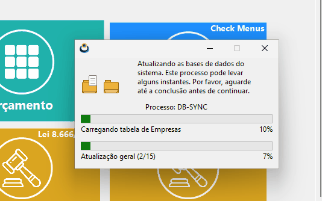

## HBNAP API Reference

### HBNAP_TIMER_START

Starts a generic interval timer, driven by NAppGUI's own application tick (so it still runs on each platform's real native message loop - Win32/macOS/GTK3). Not tied to any form: the callback block decides what to do with it, typically updating one or more forms. See [Multithreading](#multithreading).

```
N_TIMER_ID := HBNAP_TIMER_START(0.050, {|| UPDATE_PROGRESS(O_FORM) })

PAR1: Interval, in seconds, between calls to the callback block.
PAR2: Code block to execute on every tick. If it returns .F., the timer
      stops itself (no need to call HBNAP_TIMER_STOP() in that case).
RET: Timer id, to be used later with HBNAP_TIMER_STOP().
```

### HBNAP_TIMER_STOP

Stops and removes a timer previously started with `HBNAP_TIMER_START()`.

```
HBNAP_TIMER_STOP(N_TIMER_ID)

PAR1: Timer id, as returned by HBNAP_TIMER_START().
```

### HBNAP_FORMS_LOAD

Loads a form from a `*.nfm` file on disk. These types of files are created using NAppGUI Designer.

```
LOCAL O_FORM := HBNAP_FORMS_LOAD(DIRET_FORMS() + "Company_detail.nfm", DIRET_FORMS(), hb_bitOr(HBNAP_FORMS_RESIZABLE, HBNAP_FORMS_CLOSE_ON_ESC, HBNAP_FORMS_CLOSE_ON_RETURN))

PAR1: Path to the file containing the form.
PAR2: Base path for the form resources.
PAR3: hb_bitOr() with form creation flags.
RET: Form object.

# Creation flags (in hbnap.ch)
HBNAP_FORMS_RESIZABLE       The form will be resizable. Will be ignored if HBNAP_FORMS_EMBEDDED_PANEL is set.
HBNAP_FORMS_CLOSE_ON_ESC    The form can be closed with [ESC] key. Will be ignored if HBNAP_FORMS_EMBEDDED_PANEL is set.
HBNAP_FORMS_CLOSE_ON_RETURN The form can be closed with [RETURN] key. Will be ignored if HBNAP_FORMS_EMBEDDED_PANEL is set.
HBNAP_FORMS_EMBEDDED_PANEL  The form is an inner panel (embedded), not a top-level window.
```

### HBNAP_FORMS_DESTROY

Destroys a form, when it is no longer needed. All associated resources and memory will be freed.

```
HBNAP_FORMS_DESTROY(O_FORM)

PAR1: Form object.
```

### HBNAP_FORMS_TITLE

Set a title for the form window.

```
HBNAP_FORMS_TITLE(O_FORM, "Inclusão de empresa")

PAR1: Form object.
PAR2: Text string in UTF8 with the title.
```

### HBNAP_FORMS_SET_TEXT

Sets the text for a widget within the form. Access to the widget is done using the cell identifier. The widgets that respond to this function are:

- Push Button
- Check Box
- Radio Button
- Label
- Edit Box
- Combo Box
- Text View

```
HBNAP_FORMS_SET_TEXT(O_MAINWINDOW, "version", "Versão 25.1h(b426)-S07688")

PAR1: Form object.
PAR2: Widget cell name.
PAR3: Text string in UTF8.
```

### HBNAP_FORMS_SET_INT

Sets a integer value for a widget within the form. Access to the widget is done using the cell identifier. The widgets that respond to this function are:

- Label (will display the value)
- Edit Box (will show the value for edit)
- PopUp (will select the item in 'value' position)
- List Box (will select the item in 'value' position)
- Tab Control (will select the tab in 'value' position)

```
HBNAP_FORMS_SET_INT(O_MAINWINDOW, "popup_1", 3)

PAR1: Form object.
PAR2: Widget cell name.
PAR3: Integer value
```

### HBNAP_FORMS_SET_REAL

Sets a real (floating point) value for a widget within the form. Access to the widget is done using the cell identifier. The widgets that respond to this function are:

- Progress Bar (0 to 1 range)

```
HBNAP_FORMS_SET_REAL(O_FORM, "progress1", 0.75)

PAR1: Form object.
PAR2: Widget cell name.
PAR3: Real value.
```

### HBNAP_FORMS_INSERT_TEXT

Add text to the end of a widget, without deleting previous text. Access to the widget is done using the cell identifier. The widgets that respond to this function are:

- Text View

```
HBNAP_FORMS_INSERT_TEXT(O_FORM, "textview", "And this text will be added at the end")

PAR1: Form object.
PAR2: Widget cell name.
PAR3: Text string in UTF8.
```

### HBNAP_FORMS_GET_INT

Gets the integer value associated with the state of a widget.
The widgets that respond to this function are:

- Edit Box (the text will be converted to integer)
- PopUp (the value of selected item)
- List Box (the value of selected item)
- Tab Control (the value of selected tab)

```
N_VALUE := HBNAP_FORMS_GET_INT(O_FORM, "popup_1")

PAR1: Form object.
PAR2: Widget cell name.
RET: The integer value, or -1 if error.
```

### HBNAP_FORMS_EMBED

Embeds (swaps) an interior panel into a form at run time.

```
O_EMBEDDED := HBNAP_FORMS_LOAD(DIRET_FORMS() + "InnerPanel.nfm", DIRET_FORMS(), HBNAP_FORMS_EMBEDDED_PANEL)
N_VALUE := HBNAP_FORMS_EMBEB(O_FORM, O_EMBEDDED, "runtime_panel")

PAR1: Form object.
PAR2: Inner (embedded) form object. It must be created with HBNAP_FORMS_EMBEDDED_PANEL flag.
PAR3: Widget cell name. The widget MUST be a Panel widget.
RET: .T. if success. .F. if the panel change fails.
```

### HBNAP_FORMS_BIND

Binds a vector of pairs (id-variable) to the form. See [Data Binding](#data-binding).

```
LOCAL O_EMPRESA := { empresas->uf, empresas->codcid, empresas->cidade, empresas->codent, empresas->gestora }
LOCAL V_BIND := { ;
                    {"uf_combo", @O_EMPRESA[1] }, ;
                    {"codcid_edit", @O_EMPRESA[2] }, ;
                    {"cidade_combo", @O_EMPRESA[3] }, ;
                    {"codent_edit", @O_EMPRESA[4] }, ;
                    {"gestora_edit", @O_EMPRESA[5] } ;

HBNAP_FORMS_BIND(O_FORM, V_BIND)

PAR1: Form object.
PAR2: Pair vector (cellId-variable)
```

### HBNAP_FORMS_BIND_STORE

For those variables passed by reference to `HBNAP_FORMS_BIND()`, this function updates the value of the variable with the contents of the widget.

```
HBNAP_FORMS_BIND_STORE(O_FORM)

PAR1: Form object.
```

### HBNAP_FORMS_TABLE_BIND

Links a `TableView` control on the form to a single Harbour database. See [Table binding](#table-binding-tableview).

```
LOCAL V_COLS := { ; // table columns
    { HBNAP_LEFT, {|| empresas->uf} }, ;
    { HBNAP_LEFT, {|| empresas->codcid} }, ;
    { HBNAP_LEFT, {|| empresas->cidade} }, ;
    { HBNAP_LEFT, {|| empresas->gestora} }, ;
    { HBNAP_LEFT, {|| "Principal"} } ;
}

USE ../dados/empresas NEW SHARED
GOTO TOP

HBNAP_FORMS_TABLE_BIND(O_FORM, "table", "EMPRESAS", V_COLS)

PAR1: Form object.
PAR2: TableView cell name.
PAR3: Area alias string. Must be opened with USE...SHARED.
PAR4: Array of column descriptors { { align, block }, ... }.
      Alignment constants (hbnap.ch): HBNAP_LEFT, HBNAP_CENTER, HBNAP_RIGHT.
```

### HBNAP_FORMS_AREA_REFRESH

Refreshes the `TableView` control linked to a database in Harbour. This function must be called after having made changes from Harbour code, so that these are reflected in the table.

```
HBNAP_FORMS_AREA_REFRESH(O_FORM)

PAR1: Form object.
```

### HBNAP_FORMS_AREA_RECNO

Gets the record number (`recno`) currently selected in a `TableView` linked to a database.

```
LOCAL SRECNO := HBNAP_FORMS_AREA_RECNO(O_PARENT_FORM)
IF SRECNO != -1
    GO SRECNO
    FORM_EMPRESA_DETAIL("Alterar de empresa", O_PARENT_FORM)
    HBNAP_FORMS_AREA_REFRESH(O_PARENT_FORM)
ENDIF

PAR1: Form object.
RET: The current selected recno.
```

### HBNAP_FORMS_TREE_BIND

Links a `TableView` control to a hierarchy of N related Harbour databases, displaying them as an expandable relational tree. See [Tree binding (TableView)](#tree-binding-tableview).

```
HBNAP_FORMS_TREE_BIND(O_FORM, "table", V_AREAS, V_RELS, V_COLS)

PAR1: Form object.
PAR2: TableView cell name.
PAR3: Array of N area alias strings (N >= 2), in parent->child order.
      The root area (first element) must have an active index order already set.
      All areas must be opened with USE...SHARED.
PAR4: Array of N-1 relation descriptors { block, cdx_path, tag_name }.
      The CDX is opened and the tag is activated by HBNAP on the child area.
PAR5: Array of N column descriptor arrays { { align, block }, ... }.
      All arrays must have the same number of columns.
      Alignment constants (hbnap.ch): HBNAP_LEFT, HBNAP_CENTER, HBNAP_RIGHT.
```

### HBNAP_FORMS_ITEM_LIST

Sets a list of values in those widgets that support lists of items. These are:

- Pop Up
- Combo Box
- List Box

```
LOCAL C_CIDADE := { ;
                    "São Paulo", ;
                    "Rio de Janeiro", ;
                    "Brasília", ;
                    "Salvador", ;
                    "Fortaleza", ;
                    "Belo Horizonte", ;
                    "Manaus", ;
                    "Curitiba", ;
                    "Recife", ;
                    "Porto Alegre", ;
                    "Goiânia", ;
                    "Belém", ;
                    "Guarulhos", ;
                    "Campinas", ;
                    "São Luís" ;
              }

HBNAP_FORMS_ITEM_LIST(O_FORM, "cidade_combo", C_CIDADE)

PAR1: Form object.
PAR2: Widget cell name.
PAR3: Vector with the list of values ??(in UTF8).
```
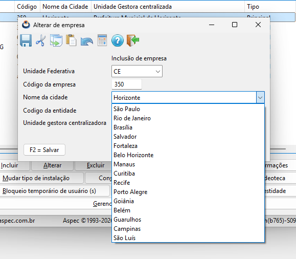

### HBNAP_FORMS_ONCLICK

Sets an event handler, in case a button on the form is pressed.

```
HBNAP_FORMS_ONCLICK(O_FORM, "add_button", {|| ADD_EMPRESA(O_FORM) })

PAR1: Form object.
PAR2: Widget (button) cell name.
PAR3: Code block to execute when the button is pressed.
```

### HBNAP_HOTKEY

Registers a window-level keyboard shortcut (hotkey) on a form. Unlike `HBNAP_FORMS_ONCLICK()`, it is not tied to any widget - it fires no matter which control currently has the focus.

```
HBNAP_HOTKEY(O_FORM, HBNAP_KEY_F1, 0, {|| INFO_MESSAGE_BOX("Help", O_FORM) })
HBNAP_HOTKEY(O_FORM, HBNAP_KEY_S, HBNAP_MOD_CONTROL, {|| GUARDAR(O_FORM) })

PAR1: Form object.
PAR2: Key code (hbnap.ch). Supported:
      - HBNAP_KEY_F1 .. HBNAP_KEY_F19 (function keys)
      - HBNAP_KEY_ESC, HBNAP_KEY_RETURN
      - HBNAP_KEY_A .. HBNAP_KEY_Z, HBNAP_KEY_0 .. HBNAP_KEY_9 (letters/numbers -
        REQUIRE at least one modifier, see PAR3. A plain letter/number with no
        modifier is rejected, since it would collide with normal text input in
        an Edit/Combo widget)
      [TAB]/[SHIFT+TAB] are NOT supported: they are reserved for widget navigation.
PAR3: hb_bitOr() of modifiers, or 0 for none:
      HBNAP_MOD_SHIFT, HBNAP_MOD_CONTROL, HBNAP_MOD_ALT
PAR4: Code block to execute when the hotkey is pressed.
```

> **Note on priority:** if the form was loaded with `HBNAP_FORMS_CLOSE_ON_ESC`/`HBNAP_FORMS_CLOSE_ON_RETURN` (see [HBNAP_FORMS_LOAD](#hbnap_forms_load)), or has a default button, that behavior always takes priority over a hotkey registered for `HBNAP_KEY_ESC`/`HBNAP_KEY_RETURN` on the same form - the hotkey will never fire for that key, since the window already consumes it first.

### HBNAP_FORMS_MAXIMIZE

Maximizes a form so that it fills the entire screen area. It is only applicable to those forms created with the `HBNAP_FORMS_RESIZABLE` flag. If the form is not already visible, it will be displayed maximized when activated.

```
HBNAP_FORMS_MAXIMIZE(O_MAINWINDOW)

PAR1: Form object.
```

### HBNAP_FORMS_SHOW

Activate the form as the main application window. It is not recommended to use this function if there are already open windows. For those cases use `HBNAP_FORMS_MODAL()`.

```
HBNAP_FORMS_SHOW(O_MAINWINDOW, {|| MAIN_WINDOW_CLOSE() })

PAR1: Form object.
PAR2: Code block to be executed when the window close button [X] is pressed.
      If the block returns .F., the close is vetoed and the window stays open.
```

### HBNAP_FORMS_MODAL

Run a form in modal mode. The previous form (parent) will be locked until this form is closed.

```
N_RES := HBNAP_FORMS_MODAL(O_FORM, O_PARENT_FORM, {|| ON_CLOSE_PRESSED() })

IF N_RES == HBNAP_CLOSED_BY_ESC
ELSEIF N_RES == HBNAP_CLOSED_BY_RETURN
ELSEIF N_RES == HBNAP_CLOSED_BY_BUTTON
ELSE
ENDIF

PAR1: Form object.
PAR2: Parent form object.
PAR3: (Optional) Code block to be executed when the window close button [X]
      is pressed. If the block returns .F., the close is vetoed and the
      dialog stays open. Any other result (including omitting this block)
      allows the close to proceed normally.
RET: Integer with the modal execution result.

# Return values (in hbnap.ch)
HBNAP_CLOSED_BY_ESC     Form closed by [ESC] key.
HBNAP_CLOSED_BY_RETURN  Form closed by [RETURN] key.
HBNAP_CLOSED_BY_BUTTON  Form closed by [X] button in title bar.
..OTHER..               Form close programmatically by HBNAP_FORMS_STOP_MODAL()
```

### HBNAP_FORMS_MODAL_GTNAP

Same as `HBNAP_FORMS_MODAL()` but considering that the parent window is a GTNAP window (semigraphic mode). These windows are controlled internally by GTNAP and do not have an object accessible from Harbour.

```
N_RES := HBNAP_FORMS_MODAL_GTNAP(O_MAINWINDOW, {|| ON_CLOSE_PRESSED() })

PAR1: Form object.
PAR2: (Optional) Code block to be executed when the window close button [X]
      is pressed. Same veto semantics as HBNAP_FORMS_MODAL().
RET: Integer with the modal execution result. Same as HBNAP_FORMS_MODAL().
```

### HBNAP_FORMS_STOP_MODAL

Detiene el ciclo modal de un formulario lanzado previamente con `HBNAP_FORMS_MODAL()` o `HBNAP_FORMS_MODAL_GTNAP()`. Se pasará el valor entero a devolver por estas funciones.

> **Important:** Stopping a modal form does not mean destroying it. We can launch it several times and we will have to call `HBNAP_FORMS_DESTROY()` when it is no longer necessary.

```
// Stop the form when press a form button
HBNAP_FORMS_ONCLICK(O_MESSAGE, "button", {|| HBNAP_FORMS_STOP_MODAL(O_MESSAGE, 100)})

PAR1: Form object.
PAR2: Integer value that will be returned by HBNAP_FORMS_MODAL().
```

### HBNAP_FORMS_CONTROL_FRAME

Returns the frame (position and size) of a form widget.

```
// Get the button frame in screen coordinates {x, y, width, height}
LOCAL V_FRAME := HBNAP_FORMS_CONTROL_FRAME(O_FORM, "button_launchpopup")

PAR1: Form object.
PAR2: Widget cell name.
RET: Widget frame
    - RET[1] X pos in screen coordinates.
    - RET[2] Y pos in screen coordinates.
    - RET[3] Widget width.
    - RET[4] Widget height.
```

### HBNAP_FORMS_UPDATE

Updates the composition of the form, in case any option has been made that modifies its structure. For example, add a menu bar.

```
HBNAP_FORMS_UPDATE(O_FORM)

PAR1: Form object.
```

### HBNAP_FORMS_MAIN_COVER

High-level function that displays an interactive options menu, within a `Scroll View` widget.

For each item we will provide this data:
- Title (in UTF8).
- Path to the icon.
- Background color (in HTML format).
- Subtitle (in UTF8).
- New? .T. or .F.
- Code block to be executed if the option is pressed.

```
LOCAL V_COVER := { ;
    { "Orçamento", DIRET_FORMS() + "images/main/grid.png", "#20B2AA", "", .F., { || BUDGET_START() }}, ;
    { "Contábil SIAFIC", DIRET_FORMS() + "images/main/calc.png", "#1E90FF", "", .F., { || ACCOUNTING_START() }}, ;
    { "Licitaçao", DIRET_FORMS() + "images/main/auction.png", "#DAA520", "Lei 8.666/1993", .F., { || BIDDING_START() }}, ;
    { "Licitaçao", DIRET_FORMS() + "images/main/auction.png", "#DAA520", "Lei 14.133/2021", .T., { || BIDDING_NEW_START() }}, ;
    { "PPA", DIRET_FORMS() + "images/main/trend.png", "#FF6347", "", .F., { || TREND_START() }}, ;
    { "Patrimonial", DIRET_FORMS() + "images/main/skyline.png", "#CD853F", "", .F., { || ASSETS_START() }}, ;
    { "Almoxarifado", DIRET_FORMS() + "images/main/cubes.png", "#6A5ACD", "", .F., { || WAREHOUSE_START() }}, ;
    { "Frota", DIRET_FORMS() + "images/main/fleet.png", "#5B5784", "", .F., { || FLEET_START() }}, ;
    { "Doações", DIRET_FORMS() + "images/main/carry.png", "#8FBC8F", "", .F., { || DONATIONS_START() }}, ;
    { "Backup", DIRET_FORMS() + "images/main/backup.png", "#C0C0C0", "", .F., { || BACKUP_START() }} ;
}

HBNAP_FORMS_MAIN_COVER(O_MAINWINDOW, "canvas", "Sistema de Gestão Pública", DIRET_FORMS() + "images/logo_aspec.png", V_COVER)

PAR1: Form object.
PAR2: Scroll View cell name.
PAR3: Main menu title.
PAR4: Menu main image.
PAR5: Item list.
```

#### Keyboard navigation

The cover supports full keyboard navigation, on top of mouse clicks:

- Clicking an option with the mouse activates it directly.
- `[UP]`/`[DOWN]`/`[LEFT]`/`[RIGHT]` move the current selection across the grid, respecting the number of columns actually computed for the current window size (it is recalculated live on every resize). At the edges of the grid, the arrows simply do nothing (no wraparound).
- `[RETURN]` activates the currently selected option, same as clicking it.
- The selected option is drawn with a focus ring (in the system accent color) around its border, which scales together with the box itself when the mouse hovers over it.

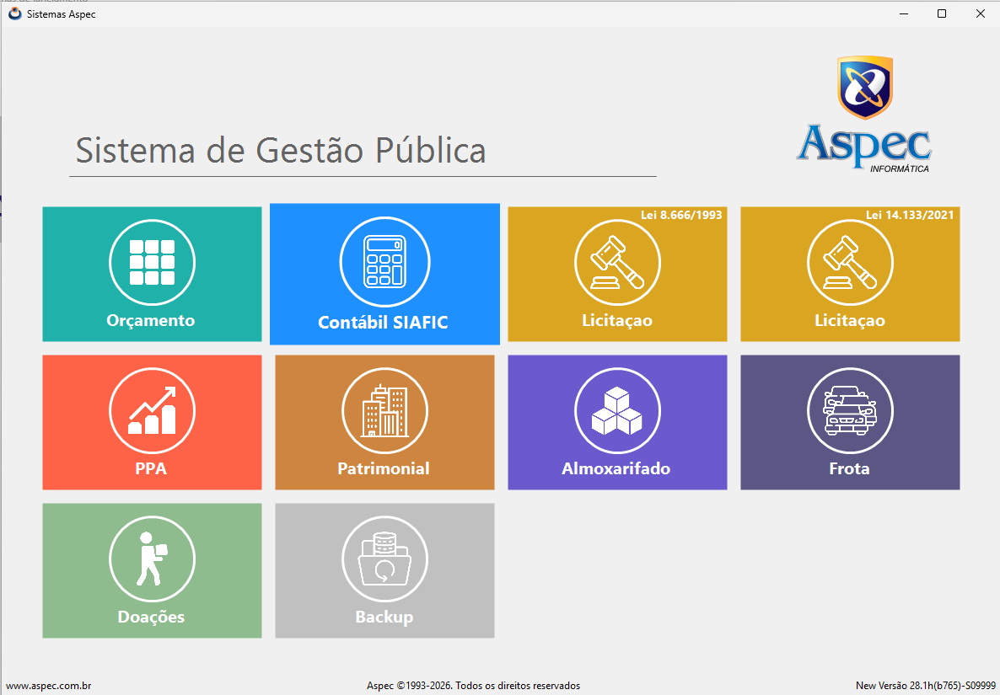

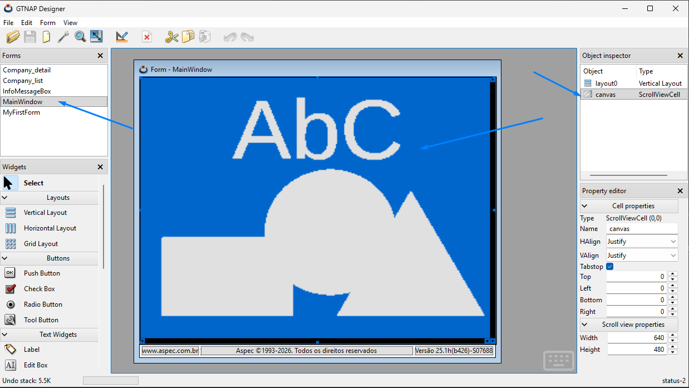

## HBNAP Menu API Reference

### HBNAP_MENU_CREATE

Create a new empty menu.

```
LOCAL O_MENU := HBNAP_MENU_CREATE()

RET: The menu object.
```

### HBNAP_MENU_DESTROY

Destroy the menu. All items and submenus will be recursively destroyed. The destructor only needs to be called with the main menu.

```
HBNAP_MENU_DESTROY(O_MENU)

PAR1: Menu object to destroy.
```

### HBNAP_MENU_ADD_ITEM

Adds a new MenuItem at the end of menu.

```
HBNAP_MENU_ADD_ITEM(O_MENU, O_ITEM)

PAR1: Menu object.
PAR2: Item object.
```

### HBNAP_MENU_INS_ITEM

Inserts a new MenuItem at an arbitrary position in the menu.

```
HBNAP_MENU_INS_ITEM(O_MENU, 2, O_ITEM)

PAR1: Menu object.
PAR2: Position (1 = First).
PAR3: Item object.
```

### HBNAP_MENU_DEL_ITEM

Removes a MenuItem from its position. The item and all associated submenus will be destroyed.

```
HBNAP_MENU_DEL_ITEM(O_MENU, 2)

PAR1: Menu object.
PAR2: Position (1 = First).
```

### HBNAP_MENU_COUNT

Returns the number of menu items.

```
LOCAL N_Size := HBNAP_MENU_COUNT(O_MENU)

PAR1: Menu object.
RET: The number of menu items.
```

### HBNAP_MENU_GET_ITEM

Gets a menuitem from its position.

```
LOCAL O_ITEM := HBNAP_MENU_GET_ITEM(O_MENU, 2)

PAR1: Menu object.
PAR2: Position (1 = First).
RET: The MenuItem object.
```

### HBNAP_MENU_BAR

Sets a menu as the main menu bar. An active form must be passed, since in Windows and Linux the menubars are linked to a window.

```
HBNAP_MENU_BAR(O_MENU, O_FORM)

PAR1: Menu object. If NIL, any previous menubar will be unlinked from the form.
PAR2: Parent HBNAP-Form.
```

### HBNAP_MENU_IS_MENUBAR

Returns .T. if the menu is currently set as the main menu bar.

```
LOCAL L_ISBAR := HBNAP_MENU_IS_MENUBAR(O_MENU)

PAR1: Menu object.
```

### HBNAP_MENU_POPUP

Launches a menu as a pop-up (contextual menu). The menu must NOT have the role of menubar.

```
HBNAP_MENU_POPUP(O_MENU, V_FORM, 200, 100)

PAR1: Menu object.
PAR2: Parent form.
PAR3: X coordinate of left-top corner in screen space.
PAR4: Y coordinate of left-top corner in screen space.
```

### HBNAP_MENUITEM_CREATE

Create a new MenuItem.

```
LOCAL O_OPENITEM := HBNAP_MENUITEM_CREATE("Open", "open.png", {| O_ITEM | ITEM_CLICKED(V_FORM, O_ITEM)})

PAR1: Item text in UTF8.
PAR2: Icon path. If NIL no icon will shown.
PAR3: Code block for click action. A reference to clicked item will always send to the callback.
RET: The MenuItem
```

### HBNAP_MENUITEM_SEPARATOR

Create a new separator item.

```
LOCAL O_SEPITEM := HBNAP_MENUITEM_SEPARATOR()

RET: The separator MenuItem
```

### HBNAP_MENUITEM_SUBMENU

Adds a submenu to a MenuItem

```
HBNAP_MENUITEM_SUBMENU(O_ITEM, O_SUBMENU)

PAR1: The MenuItem
PAR2: The submenu to add.
```

### HBNAP_MENUITEM_GET_TEXT

Gets the current text of a menu item.

```
LOCAL C_TEXT := HBNAP_MENUITEM_GET_TEXT(O_ITEM)

PAR1: The MenuItem
RET: The current text.
```

### HBNAP_MENUITEM_GET_SUBMENU

Gets the current submenu of a menu item.

```
LOCAL O_SUBMENU := HBNAP_MENUITEM_GET_SUBMENU(O_ITEM)

PAR1: The MenuItem
RET: The current submenu.
```
